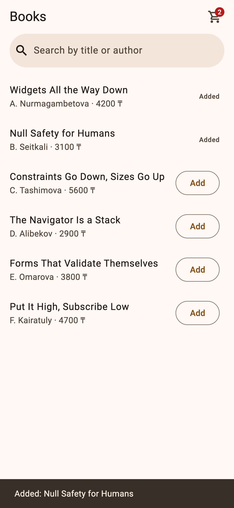
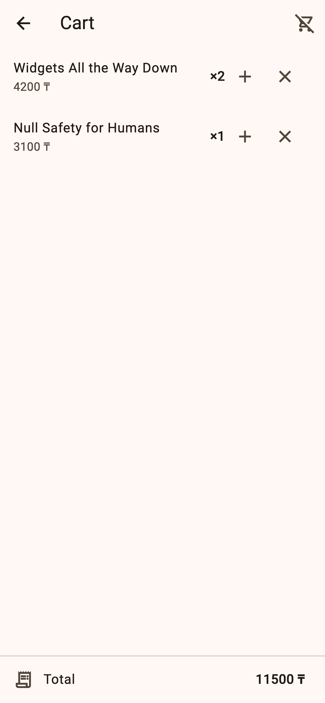

# shop

Practice 9 — *Put It High, Subscribe Low*. A Books screen with Add buttons, a
cart badge and a Cart screen on another route, built twice: first with state
lifted above `MaterialApp` (commit `lifted`), then with a `Cart`
`ChangeNotifier` provided once with `provider`.

| Books | Cart |
| --- | --- |
|  |  |

```
lib/
  main.dart            ChangeNotifierProvider above MaterialApp, two routes
  books_screen.dart    search (ephemeral), rows select "is it in the cart"
  cart_badge.dart      selects count only
  cart_screen.dart     Consumer list with ×qty / + / remove, total, Clear dialog
  models/book.dart     Book and the catalogue
  models/cart.dart     Cart: private map, add / increment / remove / clear
```

Measurements and answers are in [NOTES.md](NOTES.md).

```
flutter run
flutter test
```
