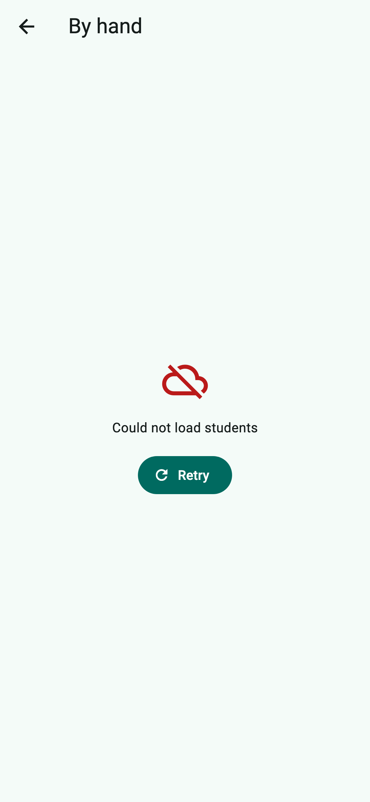
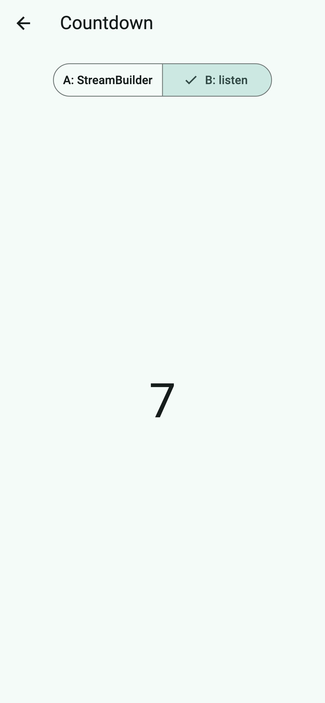

# students_async

Practice 10 — *The Data Arrives Later*. A Students screen built around a fake
API that takes two seconds and fails every third time: four states by hand,
the same screen with `FutureBuilder`, a countdown `Stream` listened to two
ways, and a Save button whose error is caught instead of lost.

| Error with Retry | Countdown, version B |
| --- | --- |
|  |  |

```
lib/
  main.dart                     MaterialApp, home is HomeScreen
  home_screen.dart              three ways in: By hand, FutureBuilder, Countdown
  api/fake_api.dart             Student, NoConnectionException, FakeApi
  api/countdown.dart            Stream<int> countdown(from) with async* / yield
  students_screen.dart          three fields, _load with try/catch + mounted, Save
  students_future_screen.dart   Future in a field, FutureBuilder, compact Switch
  countdown_screen.dart         A: StreamBuilder, B: listen + cancel in dispose
  widgets/                      LoadingView, ErrorView, EmptyView, StudentList
```

Observations are in [NOTES.md](NOTES.md).

```
flutter run -d chrome
flutter analyze   # No issues found! (unawaited_futures is on)
```
