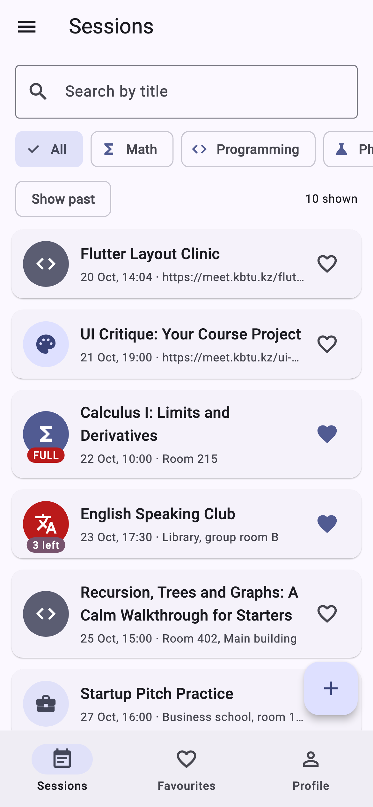
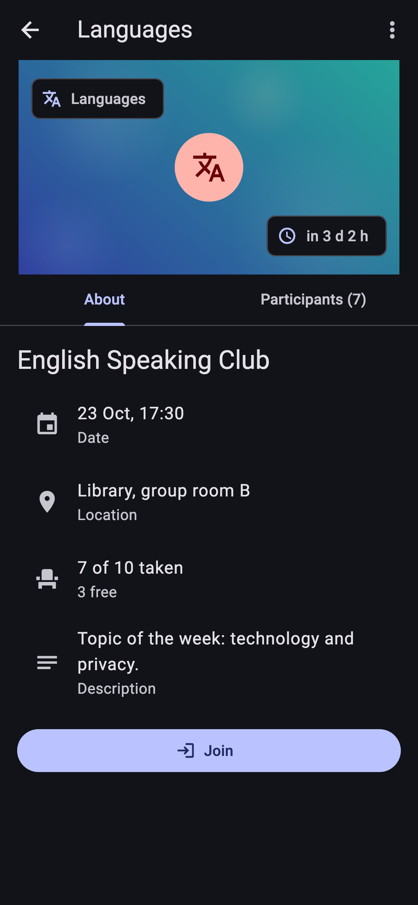
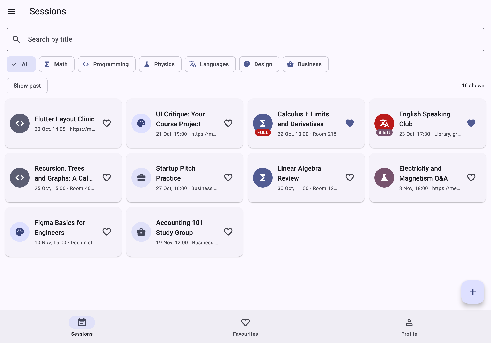

# StudyBuddy

Peer tutoring sessions at the university: find a session, join it, keep favourites, and organise your own.

Lab 1 — "Your App". Flutter 3 (stable), Dart 3, Material 3. No packages beyond the Flutter SDK and `flutter_lints`; all data lives in memory.

## Domain

| Requirement word | StudyBuddy | Type |
|---|---|---|
| Item | `Session` | immutable class, `copyWith`, `Session.empty()` |
| title | `title` | `String`, 3–60 characters |
| category | `subject` | `enum Subject` — math, programming, physics, languages, design, business |
| when | `startsAt` | `DateTime`; a session lasts 90 minutes |
| limit | `seats` | `int`, 1–500 |
| the list | `participants` | `List<String>`, read-only from outside |
| mode | `isOnline` | `bool`: the location becomes a meeting link that must contain `://` |
| place | `location` | `String` |
| optional text | `description` | `String?` |
| favourite | `isFavourite` | `bool` |
| primary action | Join / Leave | |

A second model, `Profile`, holds the user's `name` and `group` (e.g. `IT-2301`).

The twelve seed sessions are created by `seedItems()` with dates relative to today. They include a title of exactly 60 characters, a full session, two past ones, online ones, one without a description, one with 3 seats left and one that is running right now.

## Run

```bash
flutter pub get
flutter run
flutter analyze   # No issues found!
dart format .     # no changes
```

## Screenshots

| Phone, light | Phone, dark | Tablet, grid |
|---|---|---|
|  |  |  |

## Structure

```
lib/
  main.dart                  MyApp: owns ThemeMode, light + dark theme
  config.dart                every tunable number (600, 360, 5, 90 min, 1–500, 3–60)
  routes.dart                Routes, DetailArgs, FormArgs, generateRoute, unknownRoute
  shell.dart                 owns sessions + profile; NavigationBar, Drawer, FAB
  models/subject.dart        enum with label, icon and colour (exhaustive switch)
  models/session.dart        immutable Session, derived getters, places record
  models/countdown.dart      sealed Countdown: Upcoming, Started, Ended
  models/profile.dart        immutable Profile
  data/seed.dart             seedItems(): twelve sessions relative to today
  utils/format.dart          18 Oct, 10:00 and the countdown text, no packages
  tabs/list_tab.dart         search, subject chips, "Show past", list or grid
  tabs/favourites_tab.dart   favourites with the same card
  tabs/profile_tab.dart      name, group (RegExp), "You are on N lists", theme
  screens/detail_screen.dart header, live countdown, tabs, Join/Leave, Edit/Delete
  screens/form_screen.dart   one form for new and edit, PopScope, 1 s save
  widgets/session_card.dart  the one reusable card with FULL / N left badge
  widgets/empty_state.dart   the one empty state
  widgets/confirm_dialog.dart the one "are you sure?" dialog
assets/header.jpg            detail header image
```

## Decisions

The list of sessions and the profile live in the shell's `State`, one level below `MaterialApp`, so every tab and every pushed screen sees the same data and nothing has to be kept in sync. The detail screen gets the session together with callbacks because it changes a session that stays on screen (join, leave, favourite, delete), while the form only produces one finished value, so it returns it with `Navigator.pop` and the caller awaits `pushNamed<Session>`. The grid is decided by `LayoutBuilder` rather than `MediaQuery` because it measures the space the list really gets, so the same widget would still be right inside a split view or a dialog. `PopScope` compares a record of the form's current values (title, subject, mode, location, seats, date, time, description) with the record taken when the form opened; records compare field by field, so the form is dirty exactly when something really changed. `Save` calls `Navigator.pop` directly, which is why it never asks. With week 9's tools I would persist the sessions and the profile (shared storage or a small database) and move the shell's list into a state-management class, so the callbacks passed down through constructors would disappear.
